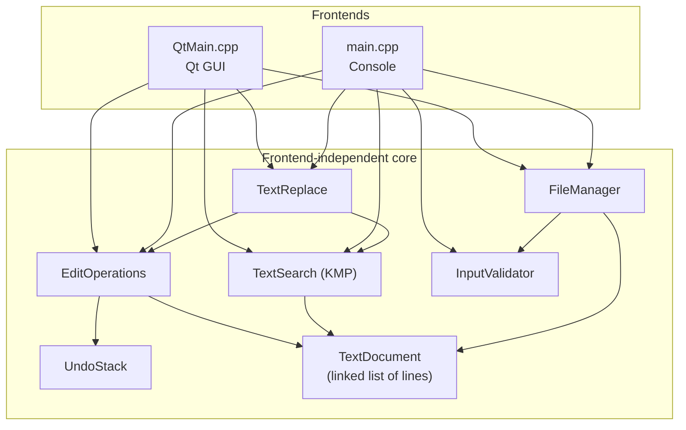

<div align="center">

# CS-218 Text Editor

**A C++17 text editor with a frontend-independent core, a modern Qt GUI and a console interface.**


</div>

The document (a doubly linked list of lines), the undo history (a bounded doubly linked
list) and the KMP search are implemented directly, without relying on `std::list` or a
ready-made editor widget. The same core powers both frontends.

---

## Table of contents

1. [Features](#1-features)
2. [Project structure](#2-project-structure)
3. [Architecture](#3-architecture)
4. [Requirements](#4-requirements)
5. [Installing the prerequisites](#5-installing-the-prerequisites)
6. [Building and running](#6-building-and-running)
7. [Using the GUI](#7-using-the-gui)
8. [Using the console version](#8-using-the-console-version)
9. [Behaviour notes](#9-behaviour-notes)
10. [Troubleshooting](#10-troubleshooting)
11. [Cleaning up](#11-cleaning-up)

---

## 1. Features

| Area | What you get |
| --- | --- |
| **File commands** | New, New Window, Open, Save, Save As, Exit. Each is clickable (sidebar and File menu) and has a shortcut. |
| **Editing** | Type directly, or insert / delete at exact line and column positions. Delete a character, a word, a range, or whole lines. |
| **Undo** | Bounded undo history. Typing is merged into sensible steps and *Replace All* is a single step. |
| **Find and Replace** | KMP search with *Match case* and *Whole word*. Every hit is listed as `Line L, Column C`; click to jump. Replace the selected hit, the first hit, or all hits. Replace All is one undo step. |
| **Safe file handling** | Files are written to a temporary file first and then moved into place, so a failed save never destroys the original. LF / CRLF endings are preserved. |
| **GUI** | Line-numbered editor, collapsible cards, light and dark theme, custom title bar, responsive layout for small screens and high-DPI displays. |
| **Console version** | Full menu-driven editor that needs only a C++17 compiler. No Qt required. |
| **Unicode** | UTF-8 throughout. Multi-byte characters are never split. |

---

## 2. Project structure

```
CS-218_TextEditor/
├── CMakeLists.txt
├── README.md
├── .gitignore
├── tests/
│   └── tests.cpp
└── CS-218_SourceCode/
    ├── TextDocument.h
    ├── TextDocument.cpp
    ├── UndoStack.h
    ├── UndoStack.cpp
    ├── EditOperations.h
    ├── EditOperations.cpp
    ├── TextSearch.h
    ├── TextSearch.cpp
    ├── TextReplace.h
    ├── TextReplace.cpp
    ├── FileManager.h
    ├── FileManager.cpp
    ├── InputValidator.h
    ├── InputValidator.cpp
    ├── DisplayManager.h
    ├── DisplayManager.cpp
    ├── PathUtil.h
    ├── main.cpp
    └── QtMain.cpp
```

Building produces two programs:

| Program | Source | Needs Qt? |
| --- | --- | --- |
| `CS218TextEditor` | GUI | Yes |
| `CS218TextEditorConsole` (CMake build) or `text_editor` (manual build) | Console | No |

---

## 3. Architecture

The backend knows nothing about any user interface. Both frontends are thin layers that
forward user actions to it.



---

## 4. Requirements

| Component | Needed for | Version |
| --- | --- | --- |
| C++17 compiler (GCC, Clang or MSVC) | Everything | GCC 9+, Clang 10+, MSVC 2019+ |
| CMake | GUI build | 3.16 or newer |
| Qt (Widgets) | GUI only | Qt 6 (recommended) or Qt 5.15 |
| Qt SVG | GUI icons (optional) | Same version as Qt |
| Ninja or Make | Faster builds (optional) | Any |

**Do you need Qt?** Only for the graphical editor. If you do not want to install Qt, use the
[console version](#a-console-version-no-qt-needed). It needs nothing but a compiler.

---

## 5. Installing the prerequisites

Skip this section if you already have a compiler, CMake and Qt. Verify with:

```bash
g++ --version
cmake --version
```

### Windows

There are three routes. **Route 1 (MSYS2)** is the quickest for the command line and VS Code,
because one tool installs the compiler, CMake and Qt together.

#### Route 1: MSYS2 (recommended)

1. Install MSYS2. Either download it from <https://www.msys2.org> or run in PowerShell:

   ```powershell
   winget install --id MSYS2.MSYS2 -e
   ```

2. Open the **MSYS2 UCRT64** shell from the Start menu and update the system. If it asks
   you to close the window, do so, reopen it and run the command once more:

   ```bash
   pacman -Syu
   ```

3. Install the toolchain, CMake, Ninja and Qt 6 (with SVG for the icons):

   ```bash
   pacman -S --needed \
       mingw-w64-ucrt-x86_64-toolchain \
       mingw-w64-ucrt-x86_64-cmake \
       mingw-w64-ucrt-x86_64-ninja \
       mingw-w64-ucrt-x86_64-qt6-base \
       mingw-w64-ucrt-x86_64-qt6-svg
   ```

   Press **Enter** to accept the default selection for the toolchain group.
   For the **console version only**, installing just `mingw-w64-ucrt-x86_64-toolchain` is enough.

4. Add the tools to your Windows `PATH` so that PowerShell and VS Code can find them
   (assumes the default folder `C:\msys64`):

   ```powershell
   [Environment]::SetEnvironmentVariable(
       "Path", $env:Path + ";C:\msys64\ucrt64\bin", "User")
   ```

5. **Close and reopen** PowerShell or VS Code, then check:

   ```powershell
   g++ --version
   cmake --version
   ninja --version
   ```

#### Route 2: Official Qt installer (Qt Creator included)

1. Download the **Qt Online Installer** from <https://www.qt.io/download-qt-installer> and sign
   in with a free Qt account.
2. Under **Qt**, tick one Qt 6 version (for example *Qt 6.7.x*) and its **MinGW 64-bit** kit.
3. Under **Developer and Designer Tools**, tick **MinGW 64-bit**, **CMake** and **Ninja**.
4. Finish the installation. The default location is `C:\Qt`.
5. Add the compiler and Qt to `PATH` (adjust the version numbers to match yours):

   ```powershell
   $qt = "C:\Qt\6.7.0\mingw_64\bin"
   $tools = "C:\Qt\Tools\mingw1120_64\bin;C:\Qt\Tools\CMake_64\bin;C:\Qt\Tools\Ninja"
   [Environment]::SetEnvironmentVariable("Path", $env:Path + ";$qt;$tools", "User")
   ```

   Folder names differ between versions, so confirm them in File Explorer.
6. Reopen the terminal and verify with `g++ --version` and `cmake --version`.

#### Route 3: Visual Studio (MSVC)

1. Install **Visual Studio 2022** (Community is free) or the *Build Tools*, with the
   workload **Desktop development with C++**.
2. Install CMake (included with the workload, or `winget install Kitware.CMake`).
3. Install Qt with the official installer (Route 2) but choose the **MSVC 2019 64-bit** or
   **MSVC 2022 64-bit** kit.
4. Use the **Developer PowerShell for VS 2022** for all build commands.

> Do not mix compilers. A Qt built for MinGW must be used with MinGW (g++), and a Qt built for
> MSVC with MSVC.

### Linux

**Debian / Ubuntu / Linux Mint**

```bash
sudo apt update
sudo apt install -y build-essential cmake ninja-build \
    qt6-base-dev qt6-svg-dev libgl1-mesa-dev libxcb-cursor0
```

(For Qt 5 instead, install `qtbase5-dev libqt5svg5-dev`.)

**Fedora / RHEL**

```bash
sudo dnf install -y gcc-c++ cmake ninja-build \
    qt6-qtbase-devel qt6-qtsvg-devel mesa-libGL-devel
```

**Arch / Manjaro**

```bash
sudo pacman -S --needed base-devel cmake ninja qt6-base qt6-svg
```

**Console version only:** install just `build-essential` (Debian family), `gcc-c++` (Fedora)
or `base-devel` (Arch).

### macOS

1. Install the command line tools (this gives you `clang++`):

   ```bash
   xcode-select --install
   ```

2. Install [Homebrew](https://brew.sh) if you do not have it, then:

   ```bash
   brew install cmake ninja qt
   ```

   For the **console version only**, the command line tools are enough.

---

## 6. Building and running

Open a terminal in the project folder, the one that contains `CMakeLists.txt`.
In VS Code: **File → Open Folder…**, then **Terminal → New Terminal** (<kbd>Ctrl</kbd>+<kbd>`</kbd>).

### A. Console version (no Qt needed)

Compile every `.cpp` file **except** `QtMain.cpp`.

**Windows (PowerShell) with MinGW / MSYS2**

```powershell
Set-Location CS-218_SourceCode
$sources = (Get-ChildItem -Filter *.cpp | Where-Object Name -ne "QtMain.cpp").FullName
g++ -std=c++17 -Wall -Wextra -Wpedantic -Wconversion -Wshadow $sources -o text_editor.exe
.\text_editor.exe
```

If your terminal is already inside `CS-218_SourceCode`, skip the first line.

**Windows (Developer PowerShell) with MSVC**

```powershell
Set-Location CS-218_SourceCode
$sources = (Get-ChildItem -Filter *.cpp | Where-Object Name -ne "QtMain.cpp").FullName
cl /std:c++17 /EHsc /W4 /utf-8 $sources /Fe:text_editor.exe
.\text_editor.exe
```

**Linux / macOS**

```bash
cd CS-218_SourceCode
g++ -std=c++17 -Wall -Wextra -Wpedantic -Wconversion -Wshadow \
    $(ls *.cpp | grep -v QtMain.cpp) -o text_editor
./text_editor
```

On macOS, use `clang++` in place of `g++` if `g++` is not installed.

### B. GUI version (Qt + CMake)

The configure step (`cmake -S . -B build`) needs Qt. If you only want the console program, use
section A.

#### Windows with MSYS2 / MinGW (Route 1 or Route 2)

```powershell
cmake -S . -B build -G Ninja -DCMAKE_BUILD_TYPE=Release
cmake --build build
.\build\CS218TextEditor.exe
```

Use `-G "MinGW Makefiles"` if you did not install Ninja.

If CMake cannot find Qt (typical for Route 2), tell it where Qt lives:

```powershell
cmake -S . -B build -G Ninja -DCMAKE_BUILD_TYPE=Release `
      -DCMAKE_PREFIX_PATH="C:/Qt/6.7.0/mingw_64"
```

#### Windows with Visual Studio (Route 3)

From the **Developer PowerShell for VS 2022**:

```powershell
cmake -S . -B build -G "Visual Studio 17 2022" -A x64 `
      -DCMAKE_PREFIX_PATH="C:/Qt/6.7.0/msvc2019_64"
cmake --build build --config Release
.\build\Release\CS218TextEditor.exe
```

#### Linux

```bash
cmake -S . -B build -G Ninja -DCMAKE_BUILD_TYPE=Release
cmake --build build
./build/CS218TextEditor
```

Drop `-G Ninja` to use Make. For a Qt installed in a custom folder, add
`-DCMAKE_PREFIX_PATH=/path/to/Qt/6.x/gcc_64`.

#### macOS

```bash
cmake -S . -B build -G Ninja -DCMAKE_BUILD_TYPE=Release \
      -DCMAKE_PREFIX_PATH="$(brew --prefix qt)"
cmake --build build
./build/CS218TextEditor
```

#### Qt Creator

1. **File → Open File or Project…** and choose `CMakeLists.txt`.
2. Select a kit (for example *Desktop Qt 6.x MinGW 64-bit*) and click **Configure Project**.
3. Press <kbd>Ctrl</kbd>+<kbd>R</kbd> to build and run.

#### VS Code

1. Install the extensions **C/C++** and **CMake Tools** (both by Microsoft).
2. Open the project folder, press <kbd>Ctrl</kbd>+<kbd>Shift</kbd>+<kbd>P</kbd> and run
   **CMake: Select a Kit** (choose the MinGW / GCC / MSVC kit that matches your Qt).
3. Run **CMake: Configure**, then **CMake: Build**, then **CMake: Run Without Debugging**.
   Or simply use the terminal commands above.

### Rebuilding after you change the code

The configure step only needs to be run once. Afterwards:

```bash
cmake --build build
```

### Starting from scratch (clean build)

Do this after changing compilers, Qt versions or generators.

```powershell
Remove-Item -Recurse -Force build        # Windows PowerShell
cmake -S . -B build -G Ninja
cmake --build build
```

```bash
rm -rf build                             # Linux / macOS
cmake -S . -B build -G Ninja
cmake --build build
```

### Sharing the Windows GUI program with someone who has no Qt

A copied `.exe` will not start without the Qt DLLs. Bundle them with Qt's deployment tool:

```powershell
windeployqt --release --no-translations .\build\CS218TextEditor.exe
```

Then zip the whole folder that contains the `.exe` (with the newly added DLLs and the
`platforms` folder). With MSYS2 the tool is already on `PATH`; with the official installer it
is in `C:\Qt\6.x.x\<kit>\bin`. On macOS use `macdeployqt` instead.

---

## 7. Using the GUI

### File commands

Every file command can be used three ways: the **sidebar** button, the **File** menu at the
top left, or the **keyboard shortcut**. All three trigger exactly the same action.

| Command | What it does | Shortcut |
| --- | --- | --- |
| **New** | Starts an empty document in this window (asks first if there are unsaved changes). | `Ctrl+N` |
| **New Window** | Opens another, independent editor window with its own document and undo history. | `Ctrl+Shift+N` |
| **Open…** | Opens a text file (asks first about unsaved changes). | `Ctrl+O` |
| **Save** | Writes to the current file. A new, unnamed document asks for a file name. | `Ctrl+S` |
| **Save As…** | Always asks for a file name. Adds `.txt` if you type no extension. | `Ctrl+Shift+S` |
| **Exit** | Closes the window; asks Save / Discard / Cancel when there are unsaved changes. | `Ctrl+Q` |

Hover any sidebar button to see its shortcut. In the narrow icon-only sidebar, the tooltip also
shows the command name.

### Other shortcuts

| Action | Shortcut |
| --- | --- |
| Undo | `Ctrl+Z` |
| Focus the search box | `Ctrl+F` |
| Focus the replace box | `Ctrl+H` |
| Find next | `F3` (or `Enter` in the search box) |

### Interface overview

* **Sidebar:** Home, New, New Window, Open, Save, Save As, Settings, Help, Exit, and the
  encoding indicator (UTF-8).
* **Toolbar:** Undo, Insert menu (text at cursor, new line above or below), New line, Delete
  character, Delete word, Delete range, Delete lines, a search shortcut, and the light / dark
  switch.
* **Editor:** line-numbered, with a tab showing the file name (`*` means unsaved changes).
* **Find & Replace card:** search text, *Match case* and *Whole word* options, and a list of
  every occurrence as `Line L, Column C`. Click an entry to jump to it. *Replace* acts on the
  selected hit and *Replace All* on every hit.
* **Undo Stack card:** shows how many of the 50 operations are stored and offers *Undo last
  operation*.
* **Insert / Delete, Delete Lines and Delete Range cards:** act on exact line and column
  positions.
* **Status card:** current line and column, line, word and character counts, and whether
  everything is saved.
* **Settings:** the dark theme switch (also available in the toolbar). The choice is
  remembered between runs.
* **Window:** the app draws its own title bar. Drag it to move the window, drag the edges to
  resize, and double-click it to maximise.

### Responsive layout

The window sizes itself from the usable screen area (taskbar excluded). Below about 1200 px wide
the sidebar becomes an icon-only rail and the toolbar drops its labels (hover for tooltips). On
short screens (about 768 px high) the status card becomes a compact row. If a very small display
still cannot hold everything, the content area scrolls instead of being clipped. High-DPI scaling
(100 % / 125 % / 150 %) is enabled.

---

## 8. Using the console version

Start `text_editor` (or `CS218TextEditorConsole` when built with CMake). Type the number of a
menu entry and press Enter.

| Group | Option | Action |
| --- | --- | --- |
| **File** | `01` | New document |
| | `02` | Open a file |
| | `03` | Save |
| | `04` | Save As |
| | `00` | Exit (offers Save / Discard / Cancel if there are unsaved changes) |
| **View** | `05` | Show the whole document |
| | `06` | Show one line |
| | `17` | Statistics (lines and characters) |
| | `18` | Show all lines with numbers |
| **Edit** | `07` | Insert text at a line and column |
| | `08` | Delete a range of characters (line, start column, count) |
| | `09` | Delete a word |
| | `10` | Insert a line |
| | `11` | Delete a line |
| | `12` | Delete a range of lines |
| **Search** | `13` | Search (KMP) |
| | `14` | Replace first occurrence |
| | `15` | Replace all occurrences |
| **History** | `16` | Undo the last operation |

In the console version lines are numbered from 1 and columns from 0 (the GUI shows columns from 1). The header always shows the current file name and whether
the document is `[Saved]` or `[Unsaved]`.

If accented or non-Latin characters look garbled in the Windows console, switch it to UTF-8
first with `chcp 65001`.

---

## 9. Behaviour notes

* **Undo** keeps the newest 100 operations in the console version and 50 in the GUI. When the
  history is full, the oldest entry is discarded, so editing never stops. Consecutive typing or
  deleting on one line is merged into a single undo step of at most 64 bytes. *Replace All* is
  always one undo step.
* **Text encoding** is UTF-8. Columns inside the core are byte offsets; the GUI converts to and
  from characters. Deleting a character removes the whole character, and edits that would split
  a multi-byte character are rejected.
* **Search and replace** treat spaces as ordinary text. Replacement requires a non-empty
  search pattern and a non-empty document; replacement text cannot contain line breaks.
  A rejected request leaves the document unchanged. Replace All changes every non-overlapping
  match as one undo step. Case-insensitive matching folds ASCII letters only.
* **Files** are read and written as bytes. A file's line-ending style (LF or CRLF) is detected on
  open and kept on save; new documents use the platform default. Saving writes to a temporary
  file first and then replaces the target, so a failure never leaves a half-written file.
  Relative paths such as `../notes.txt` are accepted.
* **Unsaved changes** are guarded everywhere the document could be lost: New, Open, Exit and
  closing the window all ask first.
* **Several windows:** *New Window* starts a separate process. Each window has its own document
  and undo history, and they share only the saved theme preference.

---

## 10. Troubleshooting

| Problem | Cause and fix |
| --- | --- |
| `g++ is not recognized` | The compiler is not on `PATH`. Add `C:\msys64\ucrt64\bin` (see [Route 1](#route-1-msys2-recommended)), then reopen the terminal. |
| `cmake is not recognized` | CMake is not installed or not on `PATH`. Install it (`winget install Kitware.CMake`, `sudo apt install cmake`, `brew install cmake`) and reopen the terminal. |
| `Could not find a package configuration file provided by "Qt6"` (or `Qt5`) | CMake cannot see Qt. Add `-DCMAKE_PREFIX_PATH="<path to your Qt kit>"`, for example `C:/Qt/6.7.0/mingw_64`. |
| `No CMAKE_CXX_COMPILER could be found` | Use the right shell (MSYS2 UCRT64, Developer PowerShell) or choose a generator that matches your compiler (`-G Ninja`, `-G "MinGW Makefiles"`). |
| Configure fails after switching compiler, Qt or generator | Stale cache. Delete the `build` folder and configure again (see *Starting from scratch*). |
| Linker errors mentioning Qt after a compiler mix-up | MinGW Qt must be built with MinGW and MSVC Qt with MSVC. Delete `build` and use matching tools. |
| The program fails at start with `Qt6Widgets.dll was not found` (or `Qt6Core.dll`) | The Qt DLLs are not found. Add the Qt `bin` folder to `PATH`, or run `windeployqt` on the `.exe`. |
| `no Qt platform plugin could be initialized` | The `platforms` folder is missing next to the `.exe`. Run `windeployqt` on it. |
| `Could not load the Qt platform plugin "xcb"` (Linux) | Install the missing library: `sudo apt install libxcb-cursor0` (and `libxcb-xinerama0` on some systems). |
| The GUI runs but shows no icons | Qt SVG is not installed. Install it (`qt6-svg` / `qt6-svg-dev` / `qt6-qtsvg-devel`) and rebuild. Everything else works without icons. |
| `.\build\CS218TextEditor.exe` is not found | Multi-config generators such as Visual Studio put it in `build\Release\` or `build\Debug\`. |
| `cannot open output file text_editor.exe: Permission denied` | The program is still running. Close it and compile again. |
| `-Wconversion` / `-Wshadow` warnings | These strict flags are optional. Remove them if you only want a quick build. |
| Garbled characters in the Windows console | Run `chcp 65001` before starting the console program. |
| Save As reports that the name is invalid | File names containing the characters `<` `>` `"` `|` `?` `*` are rejected. Choose a different name. |

If something is still wrong, copy the **complete** error text. The first error line is usually
the important one, because later errors often follow from it.

---

## 11. Cleaning up

```powershell
Remove-Item -Recurse -Force build        # Windows PowerShell
```

```bash
rm -rf build                             # Linux / macOS
```

Programs built with the manual commands (`text_editor`, `text_editor.exe`) can simply be deleted.
The GUI stores one preference, the light / dark theme, using `QSettings`. On Windows it is in the
registry under `HKEY_CURRENT_USER\Software\CS-218\TextEditor`; on Linux in
`~/.config/CS-218/TextEditor.conf`.
