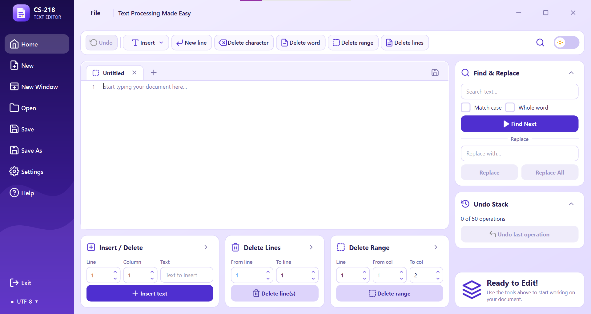
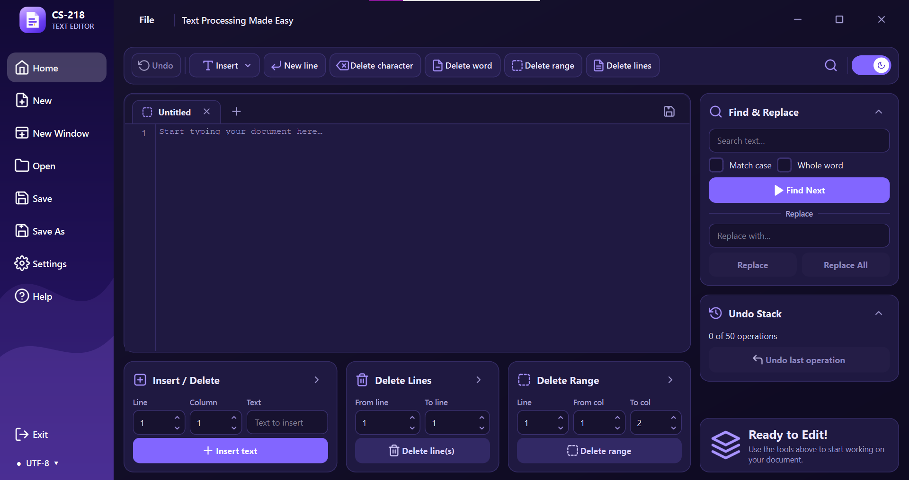

# CS-218 Text Editor

A C++ text editor with two ways to work:

- **Console version:** write and edit text using the keyboard and a numbered menu.
- **GUI version:** use a graphical window. This version requires Qt.

The console version does not require Qt.

## Screenshots

The GUI in light and dark themes:





## Project files

```text
CS-218_TextEditor/
|-- CMakeLists.txt
|-- README.md
|-- tests/
|   `-- tests.cpp
`-- CS-218_SourceCode/
    |-- TextDocument.h / .cpp
    |-- UndoStack.h / .cpp
    |-- EditOperations.h / .cpp
    |-- TextSearch.h / .cpp
    |-- TextReplace.h / .cpp
    |-- FileManager.h / .cpp
    |-- InputValidator.h / .cpp
    |-- DisplayManager.h / .cpp
    |-- PathUtil.h
    |-- main.cpp
    `-- QtMain.cpp
```

## Before you start

You need a C++17 compiler, CMake, and Ninja. Qt 6 is needed only for the GUI.

### Windows setup (MSYS2)

If these tools are not installed:

1. Install MSYS2 from <https://www.msys2.org>.
2. Open **MSYS2 UCRT64** from the Start menu and run:

   ```bash
   pacman -Syu
   ```

   If it asks you to close the terminal, reopen it and run the command again.

3. Install the compiler and build tools:

   ```bash
   pacman -S --needed mingw-w64-ucrt-x86_64-toolchain mingw-w64-ucrt-x86_64-cmake mingw-w64-ucrt-x86_64-ninja
   ```

4. For the GUI, also install Qt:

   ```bash
   pacman -S --needed mingw-w64-ucrt-x86_64-qt6-base mingw-w64-ucrt-x86_64-qt6-svg
   ```

5. In PowerShell, add the tools to this terminal session:

   ```powershell
   $env:Path += ";C:\msys64\ucrt64\bin"
   ```

   If MSYS2 was installed somewhere else, use that location instead.

## Open the project folder

Open the folder that contains `CMakeLists.txt` in VS Code. Then choose **Terminal → New
Terminal**. Run the commands below in that terminal.

## Build and run the console version

The console program works without Qt. From the project folder, run:

```powershell
cmake -S . -B build -G Ninja
cmake --build build --target CS218TextEditorConsole
.\build\CS218TextEditorConsole.exe
```

## Build and run the GUI version

Install Qt first using the setup steps above. Then run:

```powershell
cmake -S . -B build-gui -G Ninja -DCMAKE_PREFIX_PATH="C:/msys64/ucrt64"
cmake --build build-gui --target CS218TextEditor
.\build-gui\CS218TextEditor.exe
```

If Qt is installed in a different folder, replace `C:/msys64/ucrt64` with the folder that
contains your Qt installation. If CMake says it cannot find Qt, check that Qt is installed and
that this folder is correct. On Linux or macOS, use the Qt installation folder for your system.

## Build and run the tests

The tests do not need Qt. They are compiled separately from the editor programs. Run these
commands in PowerShell from the project folder:

```powershell
New-Item -ItemType Directory -Force build | Out-Null
g++ -std=c++17 -I .\CS-218_SourceCode `
    .\tests\tests.cpp `
    .\CS-218_SourceCode\DisplayManager.cpp `
    .\CS-218_SourceCode\EditOperations.cpp `
    .\CS-218_SourceCode\FileManager.cpp `
    .\CS-218_SourceCode\InputValidator.cpp `
    .\CS-218_SourceCode\TextDocument.cpp `
    .\CS-218_SourceCode\TextReplace.cpp `
    .\CS-218_SourceCode\TextSearch.cpp `
    .\CS-218_SourceCode\UndoStack.cpp `
    -o .\build\CS218TextEditorTests.exe
if ($LASTEXITCODE -eq 0) {
    .\build\CS218TextEditorTests.exe
}
```

Each test prints `[PASS]` or `[FAIL]`. A successful run ends with `Tests failed: 0`.

On Linux or macOS, use this command instead:

```bash
mkdir -p build
g++ -std=c++17 -I CS-218_SourceCode tests/tests.cpp \
    CS-218_SourceCode/DisplayManager.cpp \
    CS-218_SourceCode/EditOperations.cpp \
    CS-218_SourceCode/FileManager.cpp \
    CS-218_SourceCode/InputValidator.cpp \
    CS-218_SourceCode/TextDocument.cpp \
    CS-218_SourceCode/TextReplace.cpp \
    CS-218_SourceCode/TextSearch.cpp \
    CS-218_SourceCode/UndoStack.cpp \
    -o build/CS218TextEditorTests
./build/CS218TextEditorTests
```

## How to use the console version

When the program starts, it automatically creates a new, empty document and enters **Write
Mode**. You can start typing right away; you do not need to choose a menu option first.

### Write Mode commands

Type a line of text and press **Enter** to add it. The line and character totals update as you
write.

| Type this | What it does |
| --- | --- |
| `:w` or `:save` | Save the document. For a new document, enter a path when asked. |
| `:menu` | Open the numbered menu. Your document stays open. |
| `:help` | Show these commands in the program. |

Any other input is treated as text. To return to writing from the menu, choose **19**.

### Menu options

At the menu, enter the option number and press **Enter**. You can type the number with or
without a leading zero.

| Option | Action |
| --- | --- |
| `00` | Exit |
| `01` | Create a new document |
| `02` | Open a text file |
| `03` | Save the current named file |
| `04` | Save As |
| `05` | Show the document |
| `06` | Show one line |
| `07` | Insert text |
| `08` | Delete a range of text |
| `09` | Delete a word |
| `10` | Insert a line |
| `11` | Delete a line |
| `12` | Delete a range of lines |
| `13` | Search for text |
| `14` | Replace the first match |
| `15` | Replace all matches |
| `16` | Undo the last edit |
| `17` | Show line and character counts |
| `18` | Show all lines with numbers |
| `19` | Return to Write Mode |
| `20` | Replace a selected occurrence |

For option **20**, enter the text to find, choose a numbered match from the
displayed locations, then enter its replacement.

Successful menu actions often return to Write Mode. If the menu is still shown, choose **19**
when you are ready to write again.

### Opening, saving, and exiting

- For option **02**, enter the file's full path, for example
  `C:\Users\YourName\Documents\notes.txt`. Do not include quotation marks.
- A new document has no filename until it is saved. In Write Mode, `:w` asks where to save it.
- From the menu, choose **04 Save As** to name a new document. **03 Save** saves a file that
  already has a name.
- When exiting with unsaved changes, type `s` to save, `d` to discard changes, or `c` to cancel
  exiting.

Lines are numbered from **1**. Columns are numbered from **0** (the first character is at
column 0). Follow the prompts for the line, column, or text needed by each menu action.

## How the project works

Both versions use the same editor code. The document code stores the text as lines. Editing
operations change those lines and save recent changes in an undo stack. Search and replace
work on the document, and the file manager handles opening and saving files. The console
version connects these features to Write Mode and the numbered menu.

## If something does not work

- **`g++` or `cmake` is not recognized:** check the setup steps and make sure
  `C:\msys64\ucrt64\bin` is on your `PATH`.
- **CMake cannot find Ninja:** install the Ninja package from the setup steps.
- **CMake cannot find Qt:** Qt is required for the GUI only. Check the Qt installation folder
  in the GUI command. The console version can still be built without Qt.
- **The program does not start:** make sure the build command completed successfully, then
  run it from the project folder using the command shown above.

For Linux or macOS, install a C++17 compiler, CMake, and Ninja with your system's package
manager. The CMake build commands are the same; start a program by using `./` before its path,
for example `./build/CS218TextEditorConsole`.
